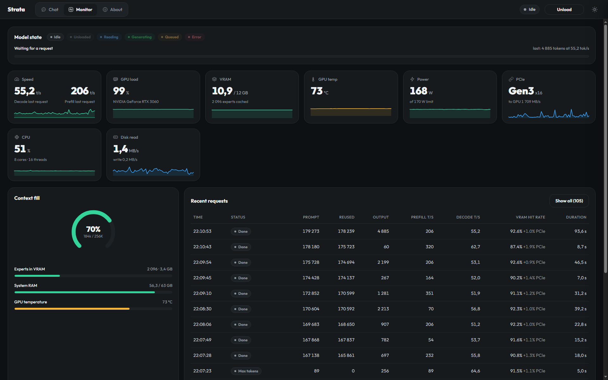

# Tuning Strata on one RTX 3060 12 GB: 44 → 61 tok/s decode at 262K context

Our own measurements of [Strata](https://github.com/Niko1221/Strata) (engine 0.1.54, app 0.2.8)
running Qwen3.8-Flash-Next **IQ3_XXS** on one GeForce RTX 3060 12 GB in a Ryzen 7 5700G desktop,
Windows 10. Every number here was produced on that machine. Raw data is in `results/`,
the scripts that made it are in `scripts/`, and the pre-boot unlock logs are in `evidence/asus3060/`.



*The Monitor page of the server itself: 31 Oct 2026, the 262K config, card unlocked, real agent traffic —
hit rate 92.0%, VRAM 10.9/12 GB, 168 W of the 170 W limit, Gen3 x16 in idle.*

Русская версия — в конце файла.

## Result

| Config (all at `--max-context 262144`) | Decode tok/s | Prefill tok/s | Expert-cache hit | Expert misses over PCIe |
| --- | ---: | ---: | ---: | ---: |
| Starting point, 131K context, `--pcie-frac 0.35`, `--spec-min-p 0.70` | 47.8 | 692 | — | — |
| 262K context, same other settings | 44.2 | 617 | — | — |
| + `--spec-min-p 0.5` | 44.0 | 618 | — | — |
| **+ `STRATA_ROUTE_PRIOR=1.5`** (chosen fast config) | **61.0** (code: 63.1) | 619 | 91.6% | 1.0% |
| fast config, `--vram-reserve-mib 1408` (safer VRAM guard) | 58.6 | 611 | — | — |
| fast config, `--prefill 7168` (later verified, see step 8) | 62.7 (32K) / 57.8 (131K) | 684.7 (32K) / 668.7 (131K) | — | — |

Decode is the engine's own figure from its log line (see Methodology). Prefill is the 7,063-token request.
The jump from 44 to 61 came from one setting, `STRATA_ROUTE_PRIOR=1.5`. Everything else moved the
number by less than the run-to-run noise we measured.

On 31 October the card itself was also unlocked pre-boot (UEFI in-RAM, see Unlock below). In that state the
fast config's prefill rose by 6.8–8.9% and the tensor rate measured at the chip's full capability
(48.7 TF/s GEMM); decode did not move. The tables above are the locked-state config.

Sweep on the chosen fast config (fresh prompts, 256 output tokens, two repetitions each; ranges are min–max):

| Prompt tokens | Prefill tok/s (median) | Decode tok/s (median, range) |
| ---: | ---: | ---: |
| 1,153 | 233.8 | 62.2 (59.9–64.6) |
| 4,393 | 539.1 | 69.7 (65.9–73.5) |
| 34,759 | 640.9 | 56.1 (55.5–56.7) |
| 138,853 | 641.0 | 60.9 (59.8–62.0) |

Same sweep, later on the same day, with `--prefill 7168` in place of `--prefill auto` (`results/raw/bench-3060-262k-prefill7168.json`):

| Prompt tokens | Prefill tok/s (median) | Decode tok/s (median, range) |
| ---: | ---: | ---: |
| 1,152 | 228.6 | 62.0 (61.1–62.9) |
| 4,392 | 534.4 | 59.2 (53.7–64.7) |
| 34,759 | **684.7** | 62.7 (58.1–67.3) |
| 138,853 | **668.7** | 57.8 (57.4–58.2) |

Prefill at 34,759 and 138,853 tokens improved by 6.8% and 4.3%; the two short prompts moved by 2% and 1%,
which is noise. Decode moved in both directions between sizes (32K better, 131K worse), so we do not attribute
any of the decode movement to this flag. See step 8.

## Hardware (exact)

| Part | Value |
| --- | --- |
| Motherboard | ASUS PRIME X570-P, BIOS 3801 |
| CPU | AMD Ryzen 7 5700G, 8 cores / 16 threads (Zen 3, integrated Radeon, display attached here) |
| RAM | 2 × 32 GB Patriot "3200 C16" kit, **running at 3000 MT/s** (DOCP not enabled) |
| GPU | ASUS GeForce RTX 3060 12 GB, PCI ID `10de:2504`, subsystem `1043:881d`, 170 W limit |
| GPU vBIOS | 94.06.2f.00.cb |
| GPU driver | 616.92 |
| OS | Windows 10 Pro 19045, Secure Boot off |
| Storage | model files on a local SSD |
| Strata | app 0.2.8, engine 0.1.54, CUDA 13 runtime from the bundled Python environment |
| Model | Qwen3.8-Flash-Next GSQ-RCO IQ3_XXS, 42.9 GB of experts, MTP draft layer (820 MiB VRAM) |

Measured on this machine: PCIe host→device 13.4 GB/s (engine probe). CPU expert pool: 7 workers on
8 physical cores; 68–74 µs per missed expert. Under the decode load the GPU held 1935 MHz,
133–135 W, 57 °C at 99% utilisation — it was not throttling.

## How we tuned it

We started from a config that already existed and changed one thing at a time, restarting the
server and benchmarking each step. The steps, in order:

1. **Measured the starting point** at 131K context: 47.8 tok/s decode, 692 tok/s prefill, 2232 expert-cache slots.
2. **Raised the context to the model's native 262,144** with `--max-context 262144`. The model was trained
   on that length, so no RoPE scaling is used. KV is streamed: `--kv q4_0 --kv-resident 32768` keeps
   32,768 cells per layer in VRAM and the rest (1.69 GiB at 262K, vs 0.84 GiB at 131K) in pinned RAM.
   Result: 44.2 tok/s. The drop from 47.8 is **not isolated**: the 262K change also made the engine
   choose smaller prompt chunks (7168 → 6400 tokens), which explains the prefill drop (692 → 617), and we did
   not run a separate control for the decode drop.
3. **Removed the hardcoded `--pcie-frac 0.35`** so the engine could tune the PCIe share from its own
   CPU measurements. It probed 0.37, then refined to 0.25 and 0.20 from the measured CPU cost per
   missed expert (72 µs, then 68 µs). At the same 1536 reserve, hardcoded 0.35 gave 45.5 tok/s and auto gave
   46.0 — within noise. We keep the auto rule: it measures this machine instead of relying on a fixed number.
4. **Set `--spec-min-p 0.5`** (Strata's own setup default; we had 0.70). Offered drafts per 256 tokens went
   from 106 to 221 and accepted drafts from 91 to 134 (acceptance rate fell from 86% to 61%). Decode did not
   change (44.2 → 44.0). Kept for parity with the default.
5. **Turned on `STRATA_ROUTE_PRIOR=1.5`** (environment variable in the config's `env` block). The router
   prefers experts already resident in the VRAM cache. Expert-cache hit rate went from 61.6% to 91.6%;
   misses over PCIe from 6.3% to 1.0%. Decode 44 → 61 (code prompt: 63.1). This is the change that matters.
6. **Tested the VRAM reserve.** Strata warns when free VRAM is under 1024 MiB because the driver may page
   GPU memory to system RAM. With `--vram-reserve-mib 1200` the card sits at 845 MiB free and the warning
   fires. At 1408 it sits at 1053 MiB, no warning, but the expert cache shrinks from 2089 to 1963 slots and
   decode drops 61.0 → 58.6. Our sweep dipped to 689 MiB free during the 131K run (the guard fired five times
   during the sweep); decode held near 60 tok/s and we saw no paging, but this is the setting we would change first
   on a different driver or a card that also drives a display.
7. **Kept the conversation cache** (`--conversation-cache-mib 6144 --conversation-cache-min-tokens 2048
   --conversation-cache-park-gain 256`). The log shows it parking 38,009 tokens in 344 ms and refusing to park
   short requests. We did not benchmark it separately.

8. **Set `--prefill 7168`** so the chunk size stays at 7,168 tokens instead of the 6,400 the engine picked at
   262K context. This recovers part of the prefill we had at 131K context: 34,759 tokens went 640.9 → **684.7**
   tok/s and 138,853 tokens went 641.0 → **668.7** tok/s, measured the same way as the sweep above
   (`0 reused`, two repetitions). Decode moved with the noise, not with the setting: 62.7 tok/s at 32K and
   57.8 at 131K, versus 56.1 and 60.9 at the auto chunk. The engine kept the same expert-cache size
   (2,093–2,096 slots) and the same VRAM situation (742–749 MiB free after the slots, same warnings).
   Keeping `--prefill auto` was never the reason for the 262K prefill drop — the chunk size was, and fixing
   the chunk recovers most of the gap while leaving the context the same.

Two candidate settings we found in the engine's documentation are **still untested**: `--kv int8` (better
long-context quality, roughly +1.7 GiB pinned RAM, smaller VRAM cache). It is listed as a next step.

## What did not work, and our mistakes

These are in the report on purpose; several cost us time.

- **Our first benchmark was wrong.** It measured decode from the time to the first streamed chunk. The server
  flushes text in waves, so it reported **103.3 and 128.6 tok/s** where the engine's own log said 47.8 and 45.5.
  The two files are kept in `results/methodology-failures/` as the example of a measurement that looks plausible.
  Fix: read decode and prefill from the engine's log line (see Methodology).
- **A restart script reported READY while the old server was still running.** Once its child process lost the
  port race, the previous config kept serving. Several restarts overlapped. Each restart now needs a check of the
  newest `engine started` line, the PID on port 8090, and `n_ctx` from `/v1/models`.
- **A Windows PowerShell 5.1 parse failure.** A script with a non-ASCII path (Cyrillic folder name) failed to
  parse under the default code page. The restart script must stay ASCII-only and use `$PSScriptRoot`.
- **Removing `--vision` from the args did nothing.** The config also has a separate `vision` block, which adds
  the flag again, so that restart was identical to the one before it. Vision stayed on for all measurements.
- **`--spec-min-p 0.5` increased drafts by ~2× and changed nothing.** The verify window was not the limit;
  the expert cache was. We learned that from the hit-rate line, not from the speed.
- **I initially blamed the VRAM reserve for a 7% decode loss.** The data does not support that: with the prior
  off, reserve 1536 and 1200 gave 44.4 and 44.2. The reserve only mattered once the prior was on. The loss from
  131K to 262K is still unexplained, see step 2.
- **Cache-slot counts moved with unrelated changes.** The same reserve gave 2232 slots at 131K and 2089 at 262K,
  so comparing slot counts across context sizes needs care.
- **Run-to-run noise is real.** The starting config measured 49.6 tok/s once (a single longer request, earlier
  the same day) and 47.8 later. Any difference under about 3 tok/s on this machine should be treated as noise
  until repeated.
- **Every sweep was measured while our own agent was using the same server.** The decode numbers show it: two
  repetitions of the same 34,759-token prompt in one run came out 57.6 and 53.1 tok/s. The prefill figures are
  stable enough to compare (within 1% run to run); decode comparisons are not, and we should not quote a decode
  difference as a finding until it is repeated on an idle server with four repetitions per size.

## Methodology

- **Decode and prefill come from the engine's own log line**, not from the HTTP stream:
  `prompt 69 tokens = 0 reused + 69 read in 1016 ms (67.9 tok/s), 256 generated in 5793 ms (44.2 tok/s), drafts accepted 91 of 106`.
  `scripts/bench_3060.py` and `scripts/engine_log_table.py` parse it.
- **Unique nonce at the start of each prompt** (`scripts/bench_sweep.py`) so no prefix can be reused. The
  check is that the line says `0 reused`.
- **Warm-up request discarded**, then the measured requests. The expert cache warms during a session, so the
  first request is not comparable with the fifth.
- **GPU sampled during the run** with `nvidia-smi` to confirm the card was not the limit.
- **GEMM numbers** (`results/raw/gemm/`) come from a harness rebuilt on this machine from the upstream
  analysis sources (MSVC + CUDA 12.6 `nvcc`, `-arch=sm_86`, cuBLAS 12.8), run with the Strata server stopped;
  clocks and power sampled via NVML, energy from `nvml_total_energy`.
- **The Monitor screenshot** is a headless rendering of the server's own Monitor page, not a screen capture.
- **Sample size is small.** Most rows are one or two requests. The sweep has two repetitions per size. Treat
  differences under about 3 tok/s as noise.

## Connection to DeepInfer's practices

[DeepSeek's DeepInfer](https://github.com/deepseek-ai/DeepInfer) does not run on this hardware: it targets
NVIDIA SM100 and Ascend 950, Linux, CUDA 13, and its README says a KV cache system is not in the open-source
release. We did not run any of its code. We used its feature list as a checklist of what determines inference
cost, and mapped each item to a Strata setting we could measure here:

| DeepInfer practice | Strata setting we used | What we measured here |
| --- | --- | --- |
| Confidence-scheduled verification, draft length cap | `--spec 4 --spec-min-p 0.5` | Drafts offered 106 → 221 per 256 tokens; decode unchanged |
| MoE expert placement (EP / EPLB) | `--expert-cache auto` + `STRATA_ROUTE_PRIOR=1.5` | Hit rate 61.6% → 91.6%; decode 44 → 61 |
| KV cache management | `--kv q4_0 --kv-resident 32768`, `--conversation-cache-mib 6144` | 262K window with 1.69 GiB KV in RAM; 38,009 tokens parked in 344 ms |
| Asynchronous scheduling | sm_86 defaults (`STRATA_ADAPT_NOWAIT`, `STRATA_ADAPT_LAG`) and `--prefill 7168` | Chunk size 6,400 → 7,168 tokens; prefill +6.8% at 34K and +4.3% at 138K |
| Deterministic measurement | greedy decoding, log-based timings, nonce prompts | Makes the numbers comparable across restarts |

DeepInfer's prefill/decode disaggregation and data-parallel load balancing have no single-GPU equivalent,
so the analogy stops there.

## Reproduce

1. Copy `configs/strata-fast.json` (or `strata-agent.json`) and replace the `<STRATA>` and `<DATA>`
   placeholders with your install and model paths. The configs bind to `127.0.0.1`; we ran ours with LAN
   access, which is a security decision for you to make.
2. Start the server elevated on Windows (the engine locks the expert arena in RAM and needs the privilege).
3. Check the newest `engine started` line in the log and `GET /v1/models` → `n_ctx` must read `262144`.
4. Run `python scripts/bench_3060.py http://127.0.0.1:8090 out.json <engine.log>` and
   `python scripts/bench_sweep.py http://127.0.0.1:8090 sweep.json <engine.log> 2 1024,4096,32768,131072`.
5. Print the per-run table with `python scripts/engine_log_table.py <engine.log>`.

## Not in this report

- Results from other people's machines (we did not compare against them in the tables).
- No GPU firmware or vBIOS changes. The UEFI in-RAM unlock was a pre-boot, in-RAM operation: nothing was
  written to the card's flash. Its full transaction story and the measured effect on these numbers are in the
  Unlock section below.
- Quality evaluation of the model under each setting. `STRATA_ROUTE_PRIOR=1.5` is documented by Strata
  as able to repeat text and weaken long agentic runs. We did not evaluate that ourselves.

## Unlock: what ran, what was refused, and what it changed

We ran the pre-boot unlock on this card (upstream project, GA106 `10de:2504` on an ASUS PRIME X570-P).
Read-only preflight on a new stick gave four agreeing cold-boot reports, the fourth with every gate
confirmed (`complete=1`, `result=pass`). One transaction then ran successfully: Bus Master enabled and
removed again, driver released, firmware stage loaded and DMA'd, selector write, PCIe FLR,
`FINAL status=0 stage=transaction attempted=1 driver_release=1 clean=1`.

Five later boots were refused on purpose (`attempted=0`, `clean=1`). Four of them are the guard working as
designed: the card came up warm, the selector registers read as zero, and the app does not write to a card it
cannot confirm is in the state the profile was built from. The fifth is worth reporting because the reason
changed. After a full power cycle the card read `SS0=0x13414010`, where the profile records `SS0=0x53414010`
from four earlier cold boots: one bit (bit 30) different, everything else identical — same chip, PLM, GFW,
WPR2, `SS1=6`, `fb_mb=0x3000`, BAR0 size and capability value. We do not know which of the two explanations
is true: that the bit varies on its own between cold boots (the upstream profile for this card masks bit 30
out of its SS0 gate), or that our transaction changed a latch that survived the power cycle. Either way the
guard stopped it, and nothing was written.

### What the throughput runs did and did not capture

All three runs below are the same config and the same sweep (engine log, fresh prompts, `0 reused`, two
repetitions). Files: `results/raw/bench-3060-262k-prefill7168.json`, `bench-3060-262k-post-run04.json`,
`bench-3060-262k-post-run09.json`.

| Prompt tokens | Prefill tok/s: baseline / run A / run B | Decode tok/s: baseline / run A / run B |
| ---: | ---: | ---: |
| 1,152 | 228.6 / 231.1 / 225.9 | 62.0 / 62.8 / 53.8 |
| 4,392 | 534.4 / 546.3 / 540.9 | 59.2 / 61.5 / 63.5 |
| 34,759 | 684.7 / 694.4 / 694.3 | 62.7 / 61.2 / 55.4 |
| 138,852 | 668.7 / 670.3 / 669.9 | 57.8 / 51.8 / 59.5 |

baseline = the sweep that established `--prefill 7168` (step 8); run A = the Windows session that followed
the successful transaction (15:36 boot); run B = the Windows session after the fifth, SS0-refused boot
(16:15 boot, nothing written).

**Run A did not carry the transaction, and we should have written this before publishing it.** Between the
transaction (15:31) and that Windows boot (15:35:50) four more UEFI boots happened, all refused, and each one
re-initialises the card before Windows starts. Run A therefore compares a baseline with a card of unknown
state, not unlocked with locked. Run B is the clean control: full power cycle, transaction refused, nothing
written. Its prefill is within 1% of the baseline at every size except 34,759 (694.3 against 684.7), which is
the same value run A produced.

Decode is not usable at this sample size: inside run B, two repetitions of the same prompt size differed by
7.7 tok/s, and our own agent session was sending traffic to the server during every sweep. Nothing in these
numbers separates a real effect from noise, and the honest summary is that no Windows measurement has been
taken yet that provably carries a completed transaction. The clean A/B is still owed.

### Gate audit, and the second transaction (RUN10)

The SS0 question was already answered upstream: their profile for this card masks bit 30 out of the SS0 gate.
We made the same decision for our profile's gate on this card: both `0x53414010` and `0x13414010` are accepted
as valid cold-state SS0. This is a gate-level setting, described in words here; nothing from the upstream
project (GPLv2) is copied into this MIT repository.

At the next cold boot (31 Oct, 16:44) the card's SS0 passed the gate (`ss0=1`), and the transaction ran to
completion:

```text
selector read: SS0=0x13414010 expected_unlock=0x88888888
selector write: SS0=0x88888888
selector read: SS1=0x6 expected_unlock=0x8
selector write: SS1=0x8
PCIe FLR returned: result=0
post-FLR SEC2 reset released, GSP halted, BME=0 pending=0
  WPR2=1ffffe00:00000000 SS0=88888888 SS1=00000008
transaction result=0 containment=0 started=1 quiesced=1 fault=0 retained=0 maps=0 FLR=1
FINAL status=0 stage=transaction attempted=1 driver_release=1 clean=1
```

The unlocked values stayed in the selector registers over the FLR; GSP was halted, WPR2 re-armed, Bus Master
cleared. That boot is the Windows session (16:59 onward) that everything measured in this section belongs to.
Full logs: `evidence/asus3060/asus3060-transaction-02.txt`; the refusal it followed is
`evidence/asus3060/asus3060-refused-run09.txt` (`cold gates: ... ss0=0`,
`FINAL status=0x8000000000000006 stage=cold-state attempted=0`); the preflight with every gate confirmed is
`evidence/asus3060/asus3060-preflight-04-confirmed.txt`.

### GEMM proof on this card, unlocked

The Strata server was stopped and the card was measured directly with CUDA GEMM (4096 × 4096 matrices,
15 s each, 5 s warm-up, 5 s idle, three runs, `0000:01:00.0`, display attached on this card). Built from the
upstream analysis harness sources: MSVC (VS 2022 BuildTools), CUDA 12.6 `nvcc`, `-arch=sm_86`, cuBLAS 12.8;
clocks and power sampled via NVML every 200 ms, energy from `nvml_total_energy`; the FP32 control is
reference-checked. Raw files: `results/raw/gemm/`.

| Benchmark | run 1 | run 2 | run 3 | avg power | median SM clock |
| --- | ---: | ---: | ---: | ---: | ---: |
| FP16 tensor, FP32 accumulate | **48.66** | **48.64** | **48.77** TF/s | 131 W | 1942–1950 MHz |
| BF16 tensor, FP32 accumulate | 50.57 | 50.44 | 50.50 TF/s | 147 W | 1980–1995 MHz |
| FP16 tensor, FP16 accumulate (control) | 47.93 | 47.81 | 47.82 TF/s | 122 W | 1792–1800 MHz |
| FP32 pedantic (control) | 8.31 | 8.31 | 8.29 TF/s | 138 W | 1815–1822 MHz |

Per gigahertz, the tensor GEMMs run at 25.0–25.4 TF/GHz — the full rate GA106 can produce. The 170 W limit
is binding: the power-brake reason bit (`0x4`) is present in every run.

A locked-state GEMM baseline for this card does not exist yet (see "What we still do not know"); the upstream
card's measured locked value was ~25.8 TF/s — half the full rate.

### The upstream card's before/after, as upstream published it

Reference only — these are upstream's numbers, from their card (vBIOS `94.06.25.00.4d`, driver 610.88,
`0000:05:00.0`, display on their second GPU), not measurements from this machine:

| Benchmark | Locked | Unlocked | Δ |
| --- | ---: | ---: | ---: |
| FP16 tensor, FP32 accumulate | 25.79 | 47.42 TF/s | +84% |
| BF16 tensor, FP32 accumulate | 25.66 | 48.58 TF/s | +89% |
| FP16 tensor, FP16 accumulate (control) | 46.54 | 46.63 TF/s | flat |
| FP32 pedantic (control) | 8.05 | 8.05 TF/s | flat |

Power during the tensor runs: 102 W locked, 131–141 W unlocked. Their card was at half rate before the
transaction, same chip family. Our card reads full-rate unlocked and reference-level on the controls, so the
comparison is consistent.

### What the unlocked state gave Strata

Same fast config, same sweep, fresh prompts, `0 reused`; two repetitions at the locked baseline
(`--prefill 7168`) and four repetitions after RUN10 (`results/raw/bench-3060-262k-post-run10-unlocked.json`).
Prefill is the comparison we can use; decode stays noise-only:

| Prompt tokens | Prefill tok/s: locked → unlocked | Δ | Decode tok/s: locked → unlocked |
| ---: | ---: | ---: | ---: |
| 1,152 | 228.6 → 244.2 | +6.8% | 62.0 → 67.9 |
| 4,392 | 534.4 → 582.2 | +8.9% | 59.2 → 66.2 |
| 34,758 | 684.7 → 744.5 | +8.7% | 62.7 → 63.9 |
| 138,852 | 668.7 → 719.8 | +7.6% | 57.8 → 61.0 |

The prefill moved consistently, well beyond the ±1% run noise; decode moved by +1.2 to +7 tok/s, and we treat
that strictly as noise (see "What did not work": agent traffic during every sweep).

A note from the run's power log (`results/raw/gpu-power-run10-sweep.csv`): the memory clock reads 7301 MHz
until 17:22:00 and 7464 MHz after, because the owner's small memory OC (below) was applied mid-sweep. Reps for
the two largest sizes partially straddle that switch, so their +8.7% / +7.6% are unlock plus, partially,
memory OC.

Single-request spot check at 7,063 tokens, `--prefill 7168`, OC'd: **618.6 → 756.5 tok/s**
(`results/raw/bench-3060-262k-post-run10-oc.json`). It combines unlock + fixed chunk + OC, and is not a clean
A/B on its own.

### A small memory OC after it

The owner applied a modest memory OC while the unlocked session was running: nvidia-smi reads the memory at
7464 MHz instead of the stock 7301 MHz (SM reads 1957–2002 MHz against a table max of 2100). Two consequences
we measured:

- Tensor GEMM did not move: reruns at 21:34 gave 48.41 / 48.15 / 47.91 TF/s against 48.66 / 48.64 / 48.77 at
  17:57 — the same ceiling, already power-capped in both sessions (`0x4` reason, 131–133 W against the 170 W
  cap). A memory OC is exactly what a compute-bound ceiling should not change.
- Under Strata decode work the power limit binds: a 45-minute sampling window
  (`results/raw/gpu-power-after-oc.csv`, 1,318 samples) shows median **167 W against the 170 W cap** at load,
  median SM 1957 MHz, memory 7464 MHz, up to 73 °C, with reason bit `0x4` active in 871 of the 1,318 samples.
- Strata decode did not move: 61.5 / 64.6 tok/s against 61.0 / 63.1 locked. Decode is bound by the CPU/RAM
  expert pool, not by the tensor rate.

### The Monitor screenshot

The screenshot is at the very top of this file. The server's own Monitor page
(`http://127.0.0.1:8090/#monitor`), rendered headless browser-side, 31 Oct 22:12,
unlocked, the 262K config, under real agent traffic. What it shows: hit rate 92.0% (542.5M cached tokens,
3,365 cached seconds); VRAM 10.9/12 GB with 2,096 experts resident; system RAM 56.3/63.5 GB; power 168 W of
the 170 W cap; 73 °C; context fill 184K / 258K; the link idle at Gen3 x16. Recent requests rows are our own
agent session (167K–179K token requests, 91–93% hit) plus the last bench request (256 tokens generated,
64.6 tok/s decode).

### What we still do not know

- **The unlock state is volatile.** The first transaction did not survive a full power cycle: after a power
  off, the card read its locked SS0 value again (`0x13414010`, in the refused run09). Warm reboots
  re-initialise the card, and the guard refuses to write to it there. The current unlocked state lives until
  the next full power-off.
- **A locked-state GEMM on this card was never measured.** We have the full-rate number; we do not have a
  measured half-rate number for this exact card. That baseline is owed, and it belongs at the next full
  power-off, before any new stick run.
- **Decode at 80–90 tok/s under Linux, observed and unconfirmed.** An unlocked boot under Linux showed that
  decode level; the engine logs were not collected, so no number derived from it is in any table here.
- **Quality.** `STRATA_ROUTE_PRIOR=1.5` has a documented concern (repeated text, weakened long agentic runs)
  and we have not evaluated it ourselves.

## Next steps

- At the next full power-off: measure the locked-state GEMM baseline for this card first (the honest "before"
  for this card), then optionally a fresh UEFI run with a same-state sweep.
- A PCIe question: every measurement on this machine ran on a Gen3 x16 link (the GEMM logs read current max
  gen/width 3 × 16). The board and the card are both 4.0-capable; forcing Gen4 in BIOS and re-running the
  host→device probe and the sweep is an open measurement.
- More repetitions before drawing any conclusion about decode: four repetitions per size, server idle, no
  agent traffic during the sweep.
- `--kv int8` versus `q4_0` at 262K.
- BIOS DOCP to run the RAM at its rated 3200 MT/s, since the CPU expert pool is memory-bound.
- A proper quality check of `STRATA_ROUTE_PRIOR=1.5` on long agentic tasks before recommending it for that use.

## License

Text, scripts and configs: MIT. Model weights, packs and NVIDIA components keep their own licenses.

---

# Русская версия (кратко)

**Результат.** Strata (движок 0.1.54) с моделью Qwen3.8-Flash-Next IQ3_XXS на одной RTX 3060 12 GB,
Ryzen 7 5700G, Windows 10, 64 GB RAM, контекст 262 144 токена. Декодирование выросло с **44 до 61 tok/s**
одной переменной `STRATA_ROUTE_PRIOR=1.5`: доля попаданий в кэш экспертов поднялась с 61.6% до 91.6%,
промахов через PCIe стало 1.0% вместо 6.3%. Остальное (`--spec-min-p 0.5`, авто-доля PCIe, резерв VRAM)
дало изменения в пределах шума. Prefill 640–641 tok/s на 34K и 138K токенах; с `--prefill 7168`
(фиксированный размер чанка вместо подобранного движком 6400) стало 684.7 и 668.7 tok/s, то есть +6.8%
и +4.3%. Скорость генерации при этом не изменилась в лучшую сторону.

**Разблокировка (31 октября, итог).** Preflight (только чтение) — четыре холодных запуска, четвёртый
со всеми подтверждёнными гейтами (`complete=1`). Первая транзакция (15:31): Bus Master включён/снят,
драйвер прошивки отпущен, FLR, `attempted=1 clean=1`. Пять последующих запусков остановлены намеренно;
пятый — из-за `SS0=0x13414010` вместо профильного `0x53414010` (отличается ровно один бит): гейт `ss0=0`,
`FINAL status=0x8000000000000006 stage=cold-state attempted=0`. В upstream-профиле этой карты бит 30
из гейта SS0 исключён — мы приняли то же решение в нашем гейте: оба значения (`0x53414010` и `0x13414010`)
принимаются как валидное холодное состояние. Это настройка уровня гейта, описанная словами; upstream-код
(GPLv2) в этот MIT-репозиторий не копируем.

**Вторая транзакция (RUN10).** На холодном запуске 16:44 карта прошла гейт (`ss0=1`), транзакция завершена:
`selector write: SS0=0x88888888`, `SS1=0x8`, `PCIe FLR returned: result=0`,
`post-FLR ... SS0=88888888 SS1=00000008`,
`FINAL status=0 stage=transaction attempted=1 driver_release=1 clean=1`.
Разблокированные значения остались в регистрах селекторов после FLR; GSP остановлен, WPR2 поднят заново,
Bus Master снят. Эта загрузка — сессия Windows (16:59 и далее), к которой относятся все замеры этого
раздела. Полные логи: `evidence/asus3060/asus3060-transaction-02.txt`, остановленный запуск —
`asus3060-refused-run09.txt`, preflight с подтверждёнными гейтами —
`asus3060-preflight-04-confirmed.txt`. Прогоны «до» (baseline / run A / run B в таблице сквозной
скорости выше) к разблокировке отношения не имеют: run A, как описано выше, транзакцию не нёс.

**GEMM-доказательство в разблокированном состоянии (сервер остановлен).** 4096×4096, 15 с, три прогона:
FP16×FP32-acc **48.66 / 48.64 / 48.77 TF/s** (медианные SM 1942–1950 MHz, 131 W),
BF16×FP32-acc 50.57 / 50.44 / 50.50 (147 W), контроль FP16×FP16 47.93 / 47.81 / 47.82 (122 W),
FP32 8.31 / 8.31 / 8.29 (138 W). На гигагерц — **25.0–25.4 TF/GHz**, полная мощность GA106; лимит 170 W
связывает (бит причины `0x4`). Для справки — числа upstream-карты (другая плата, vBIOS `94.06.25.00.4d`,
драйвер 610.88): 25.79 → 47.42 (+84%), 25.66 → 48.58 (+89%), контроли не изменились (46.54 → 46.63
и 8.05 → 8.05). GEMM-базового замера в заблокированном состоянии на нашей карте пока нет — его нужно
сделать при следующем полном выключении питания.

**Что разблокировка дала Strata.** Тот же свип, те же настройки, новые запросы, `0 reused`; два повторения
в baseline и четыре после RUN10: prefill 228.6 → 244.2, 534.4 → 582.2, 684.7 → 744.5, 668.7 → 719.8
**(+6.8…+8.9%** от baseline). Decode сдвинулся на +1.2…+7 tok/s — трактуем только как шум. Заметим:
в power-логе память переключилась с 7301 на 7464 MHz в 17:22 (владелец применил небольшой разгон памяти
посреди свипа), поэтому два самых крупных размера частично несут разгон, а не только разблокировку.
Одиночный запрос 7063 токена: 618.6 → **756.5 tok/s** — тут сложены разблокировка, фиксированный чанк
и разгон памяти; сам по себе это не чистый A/B.

**Небольшой разгон памяти после.** nvidia-smi читает память 7464 MHz вместо штатных 7301 (SM 1957–2002).
Tensor-GEMM не изменился: перезапуски 21:34 дали 48.41 / 48.15 / 47.91 против 48.66 / 48.64 / 48.77 в 17:57
— тот же предел, уже упирающийся в лимит (131–133 W против 170 W). Под decode-нагрузкой Strata лимит
властвует: 45-минутное окно (1,318 замеров, `results/raw/gpu-power-after-oc.csv`) — медианная мощность
при нагрузке **167 W против лимита 170 W**, SM-медиана 1957 MHz, до 73 °C, бит `0x4` активен
в 871 из 1,318 замеров. Decode Strata не изменился: 61.5 / 64.6 против 61.0 / 63.1 в заблокированном
состоянии — decode упирается в пул экспертов CPU/ОЗУ, а не в tensor-мощность.

**Снимок Monitor.** `assets/strata-monitor.png` — страница Monitor самого сервера (headless-рендер,
31 октября 22:12, разблокированное состояние, 262K-конфиг, реальный агентский трафик): hits 92.0%
(542.5M кэшированных токенов), VRAM 10.9/12 GB, 2096 экспертов в VRAM, RAM 56.3/63.5 GB, 168 W из 170 W,
73 °C, линия в простое Gen3 x16; в Recent requests — наши агентские запросы 167K–179K токенов
(91–93% hits) и последний бенч-запрос (64.6 tok/s decode).

**Чего мы всё ещё не знаем.** Состояние разблокировки не переживает полное выключение питания: первая
транзакция не пережила (карта снова читала заблокированное значение `SS0=0x13414010` — это отказ run09;
тёплые перезагрузки карту переинициализируют, и на них писать отказывается защита). Текущее
разблокированное состояние живёт до следующего полного выключения. GEMM-базового замера в
заблокированном состоянии нашей карты у нас нет; Linux-наблюдение (80–90 tok/s decode на
разблокированной загрузке) — логи движка не собраны, числа из него в таблицы не попадает; качество
`STRATA_ROUTE_PRIOR=1.5` не проверено.

**Железо.** ASUS PRIME X570-P (BIOS 3801), Ryzen 7 5700G (8 ядер / 16 потоков), 2×32 GB Patriot 3200 C16
(работают на 3000 MT/s), RTX 3060 12 GB ASUS (`10de:2504`, `1043:881d`), vBIOS `94.06.2f.00.cb`,
драйвер 616.92, Windows 10 Pro 19045.

**Что неудачно.** Первый бенчмарк измерял декодирование по SSE-потоку и показывал 103–128 tok/s вместо
45–48 из лога движка. Перезапуск сервера несколько раз выдавал READY, пока старый сервер держал порт.
Предположение о потере 7% из-за резерва VRAM не подтвердилось. Падение с 131K до 262K контекста пока
не объяснено изолированным тестом.

**Что дальше.** При следующем полном выключении питания: сначала сделать GEMM-замер этой карты в
заблокированном состоянии (честное «до» именно для неё), затем по желанию — новый запуск флешки и тот
же свип в разблокированном состоянии. Вопрос PCIe: все измерения на этой машине прошли на Gen3 x16
(GEMM-логи фиксируют max gen/width 3 × 16; плата и карта поддерживают 4.0 — стоит попытаться в BIOS
включить Gen4 и перемерить пробы и свип). Далее: четыре повторения свипа на idle-сервере без агентского
трафика; `--kv int8` против `q4_0` на 262K; DOCP для ОЗУ на штатные 3200 MT/s; и отдельная проверка
качества `STRATA_ROUTE_PRIOR=1.5` на длинных агентских задачах — прежде чем рекомендовать его для них.
